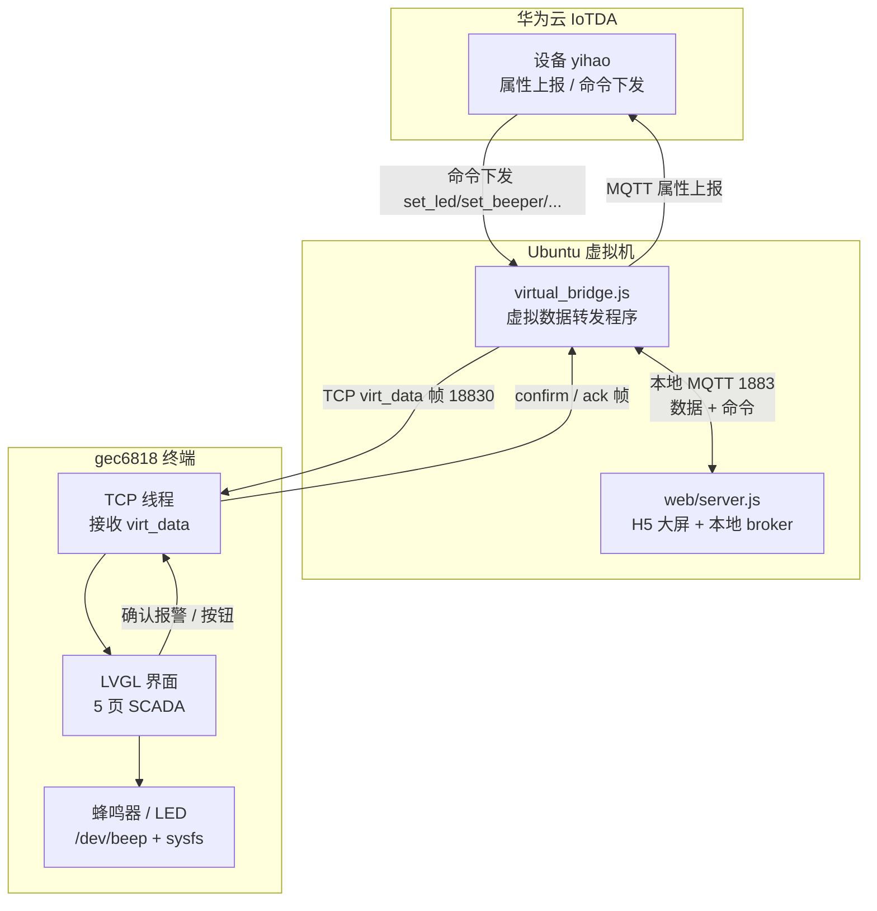
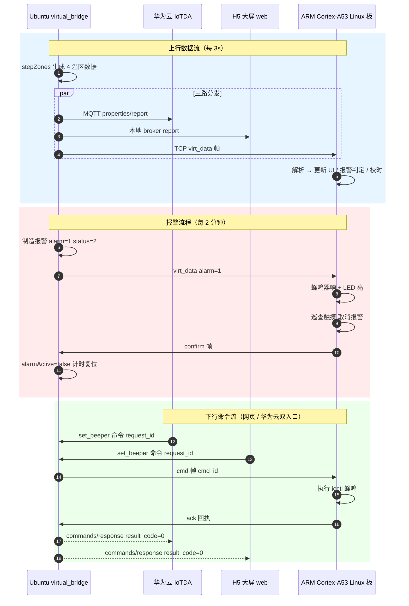
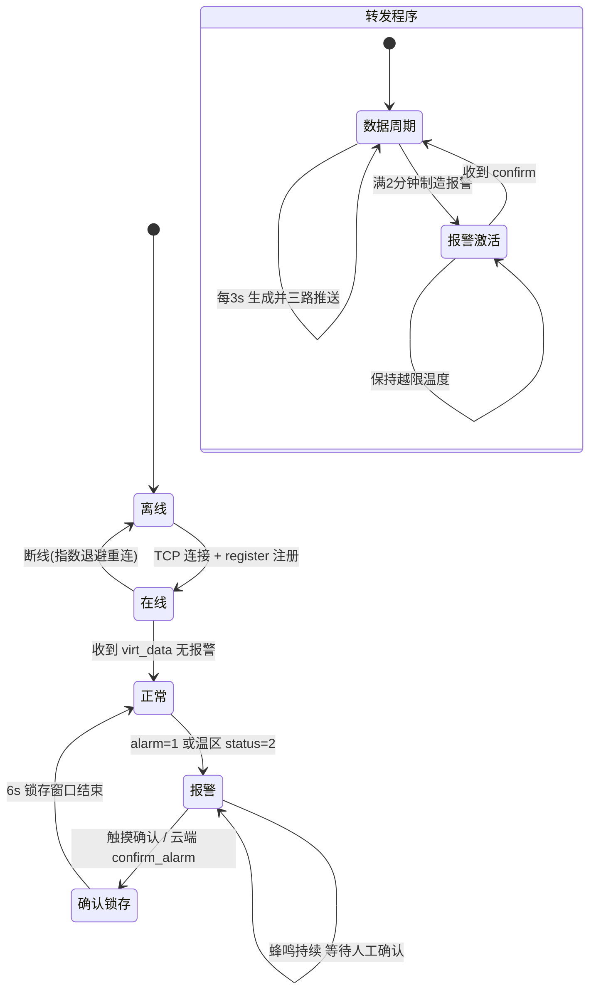
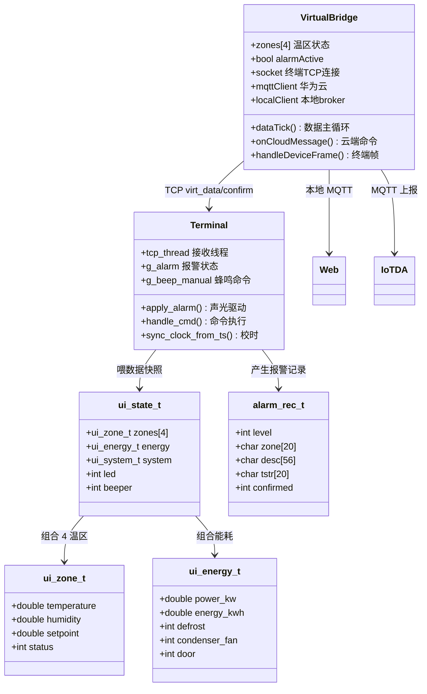
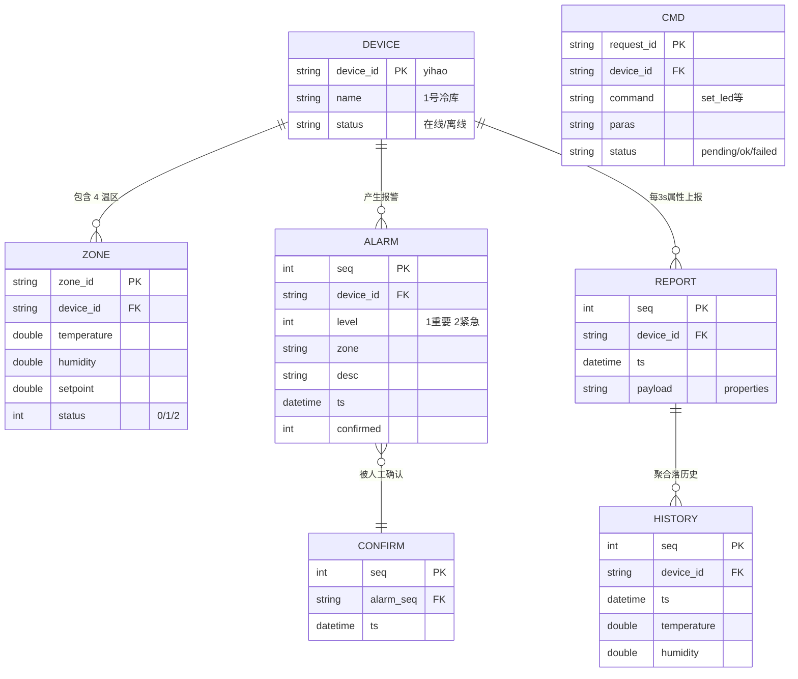

# 12-系统设计图（Mermaid）

> 对应当前验收链路：virtual-server 转发程序 + ARM Cortex-A53 Linux 板 （LVGL）+ 华为云 IoTDA + H5 大屏。
> 在支持 Mermaid 的渲染器（Obsidian / GitHub / VS Code Markdown 插件）中可直接显示。

## 1. 流程图（系统数据流）

## 2. 时序图（上行数据 / 报警 / 下行命令）

## 3. 状态图（终端 + 转发程序）

## 4. 类图（数据模型与模块接口）

## 5. ER 图（数据实体关系）

